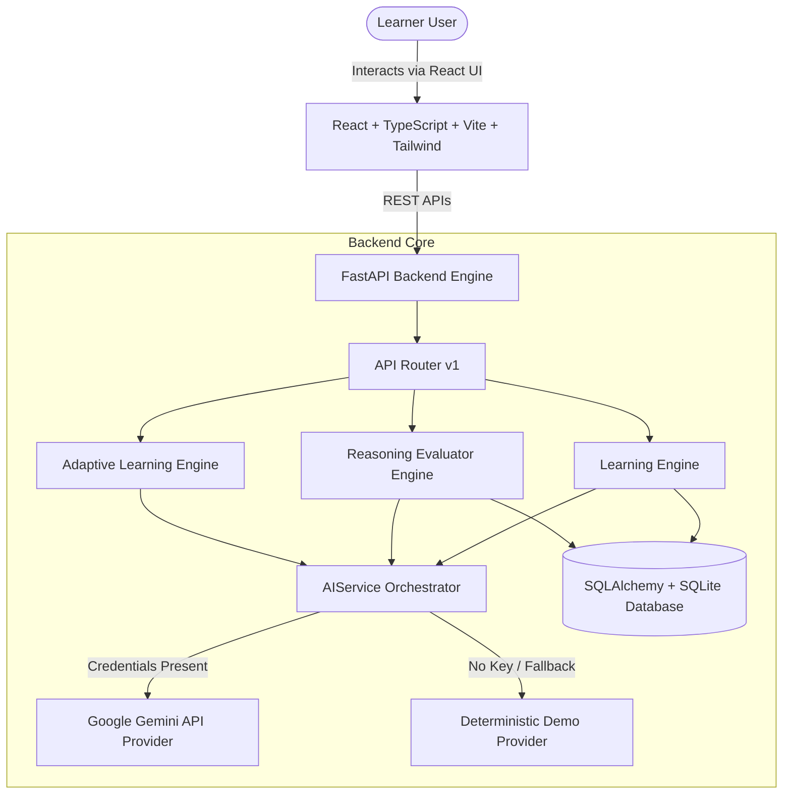

# ConceptForge AI — System Architecture & Data Pipeline

## Overview

ConceptForge AI is an adaptive AI-powered learning platform designed to evaluate **how learners think and reason**, moving beyond simple memorization and multiple-choice answer validation.

---

## High-Level Architecture



---

## AI Execution Pipeline

```text
User Topic & Goal
       ↓
Topic Understanding & Breakdown
       ↓
Concept Extraction (Main, Prerequisite, Related, Application)
       ↓
Concept Relationship Mapping (PREREQUISITE, CAUSES, DEPENDS_ON, CONTRASTS_WITH, APPLIED_IN)
       ↓
Interactive Visual Concept Map (React Flow)
       ↓
Real-World Application Challenge Generation
       ↓
Student Free-Form Reasoning Response
       ↓
AI Reasoning Evaluation (5-Axis Cognitive Profile)
       ↓
Misconception & Knowledge Gap Detection
       ↓
Adaptive Recommendation & Next Challenge Escalation
```

---

## 5-Axis Cognitive Profile

ConceptForge AI evaluates reasoning across 5 dimensions:

1. **Concept Knowledge** (82% baseline): Accuracy of underlying principles and definitions.
2. **Connections** (65% baseline): Understanding how concepts interrelate across fields.
3. **Reasoning** (74% baseline): Logical coherence and mechanistic depth of explanation.
4. **Application** (69% baseline): Ability to use concepts in novel real-world scenarios.
5. **Explanation Quality** (71% baseline): Clarity, precision, and absence of superficial buzzwords.

---

## Fail-Safe DemoProvider Fallback

To guarantee 100% operational presentation readiness during hackathon judging:
- If `GEMINI_API_KEY` or `AI_API_KEY` is not present, or if external API capacity limit is reached, `AIService` automatically routes to `DemoProvider`.
- `DemoProvider` contains rich, pre-built deterministic models for Machine Learning, Photosynthesis, Physics, SQL Joins, and TCP Congestion Control, while dynamically constructing structured plans for any arbitrary custom topic.
- A visual **Demo Mode** indicator pill informs users when fallback mode is active.
